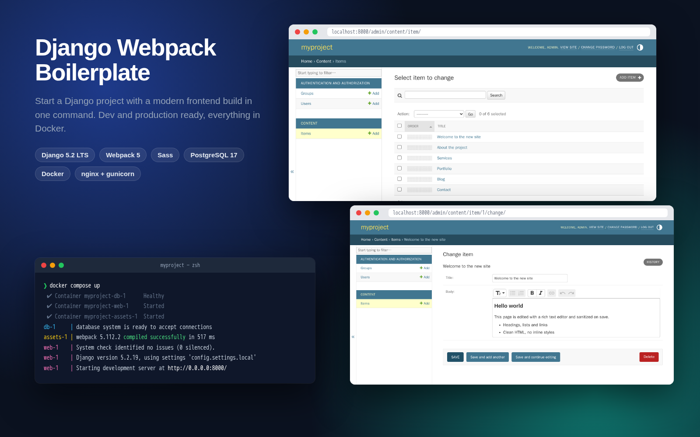

# Django Webpack Boilerplate

[English](README.md) · [Español](README.es.md)



Plantilla para empezar proyectos de Django con un frontend moderno. En lugar de configurar desde cero Django, Webpack, Sass, PostgreSQL, nginx y HTTPS en cada proyecto, copias este repo, le cambias el nombre y ejecutas `docker compose up`: arrancan a la vez la base de datos, el servidor de desarrollo de Django y webpack en modo watch, sin instalar nada en tu ordenador aparte de Docker. El mismo repo se despliega en producción con un solo comando.

## Qué incluye

- **Entorno de desarrollo con un comando**: PostgreSQL, `runserver` de Django con recarga automática y webpack recompilando Sass/JS en cada cambio.
- **Stack de producción**: imagen Docker multi-stage, gunicorn con usuario no-root, nginx sirviendo estáticos y media, migraciones y `collectstatic` automáticos.
- **Seguro por defecto**: configuración y secretos en `.env`, redirección a HTTPS, cookies seguras y HSTS opcional en producción.
- **Admin preparado para contenido**: editor de texto enriquecido con saneado del HTML en el servidor y ordenación de listados arrastrando. Incluye un modelo de ejemplo comentado.
- **Con tests**: settings de test que no necesitan ni Postgres ni el build de webpack.
- **Documentado**: guías paso a paso para proyectos nuevos, deployment en un VPS con HTTPS, dumps de Postgres y traducciones.

## Tecnologías

| Área | Tecnologías |
|---|---|
| Backend | Python 3.13, Django 5.2 LTS, PostgreSQL 17 (psycopg 3), django-environ, django-webpack-loader, [django-prose-editor](https://github.com/matthiask/django-prose-editor), [django-admin-sortable2](https://github.com/jrief/django-admin-sortable2) |
| Frontend | Webpack 5, Sass (módulos `@use`), PostCSS (postcss-preset-env), Babel, Node 24 |
| Infraestructura | Docker, Docker Compose, gunicorn, nginx |

## Arranque rápido

Solo necesitas [Docker](https://docs.docker.com/get-docker/) (con Compose v2).

```bash
git clone https://github.com/edealfonso/django-webpack-boilerplate.git
cd django-webpack-boilerplate/myproject
docker compose up --build
# en otra terminal, cuando webpack haya terminado:
docker compose exec web python manage.py migrate
docker compose exec web python manage.py createsuperuser
```

Abre http://localhost:8000 (el admin está en `/admin/`). Para empezar tu propio proyecto, cambia `myproject` por tu nombre en todas partes ([guía](docs/manuals/ES/1_CREAR_NUEVO_PROYECTO.md)).

## Documentación

- [Referencia de uso](docs/USAGE.es.md): estructura del proyecto, desarrollo, frontend, tests, producción y variables de `.env`.
- Guías paso a paso: [proyecto nuevo](docs/manuals/ES/1_CREAR_NUEVO_PROYECTO.md), [deployment en un VPS con HTTPS](docs/manuals/ES/2_DEPLOYMENT.md), [Postgres](docs/manuals/ES/BASES_DE_DATOS_POSTGRES.md), [traducciones](docs/manuals/ES/TRANSLATE.md).

## Demo

No hay demo online: es una plantilla, no una aplicación. La captura de arriba muestra lo que obtienes tras `docker compose up` (el admin de Django con el modelo de ejemplo activado).

## Qué he desarrollado yo

- Partí de la boilerplate que usábamos en mi estudio y la limpié de todo lo innecesario.
- Creé los manuales paso a paso (`docs/manuals/ES/`).
- En 2026 la actualicé y mejoré con la ayuda de [Claude Code](https://claude.com/claude-code): Docker para desarrollo y producción, Django 5.2 LTS, seguridad (secretos fuera del repo, ajustes de HTTPS), un build de frontend moderno y la documentación reescrita para Docker.

## Pendiente

- [ ] CI con GitHub Actions: ejecutar los tests y construir las imágenes de Docker en cada push
- [ ] [Ruff](https://docs.astral.sh/ruff/) como linter y formateador de Python
- [ ] Dependabot: PRs automáticas de actualización para pip, npm e imágenes de Docker
