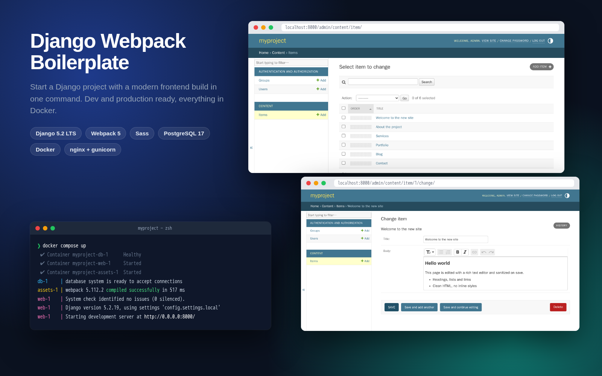

# Django Webpack Boilerplate



[English](#english) · [Español](#español)

---

## English

A starter template for Django projects with a modern frontend build. Instead of setting up Django, Webpack, Sass, PostgreSQL, nginx and HTTPS from scratch on every project, you copy this repo, rename it and run `docker compose up`: the database, the Django dev server and webpack in watch mode start together, with nothing installed on your machine except Docker. The same repo deploys to production with one command.

### Features

- **One-command dev environment**: PostgreSQL, Django `runserver` with auto-reload, and webpack rebuilding Sass/JS on every change.
- **Production stack**: multi-stage Docker image, gunicorn as a non-root user, nginx serving static and media files, automatic migrations and `collectstatic`.
- **Secure by default**: configuration and secrets in `.env`, HTTPS redirect, secure cookies and opt-in HSTS in production.
- **Admin ready for content**: rich text editor with server-side HTML sanitization, and drag & drop ordering of lists. Includes a commented example model.
- **Tested**: test settings that need neither Postgres nor a webpack build.
- **Documented**: step-by-step guides (in Spanish) for new projects, VPS deployment with HTTPS, Postgres dumps and translations.

### Tech stack

| Area | Technologies |
|---|---|
| Backend | Python 3.13, Django 5.2 LTS, PostgreSQL 17 (psycopg 3), django-environ, django-webpack-loader, [django-prose-editor](https://github.com/matthiask/django-prose-editor), [django-admin-sortable2](https://github.com/jrief/django-admin-sortable2) |
| Frontend | Webpack 5, Sass (`@use` modules), PostCSS (postcss-preset-env), Babel, Node 24 |
| Infrastructure | Docker, Docker Compose, gunicorn, nginx |

### Demo

No online demo: this is a template, not an app. The screenshot above shows what you get after `docker compose up` (Django admin with the example model enabled).

### My contribution

- Started from the boilerplate we used at the studio where I worked, and cleaned it up, removing everything that wasn't needed.
- Wrote the step-by-step manuals (`manuals/ES/`).
- In 2026 I updated and improved it with the help of [Claude Code](https://claude.com/claude-code): Docker for development and production, Django 5.2 LTS, security (secrets out of the repo, HTTPS settings), a modernized frontend build and documentation rewritten for Docker.

### Contents

- `myproject/`: the Django project
  - `config/`: settings (`base`, `local`, `prod`, `test`), urls, wsgi/asgi
  - `apps/`: example apps (`pages`, `content`) to start from. `models.py`/`admin.py` include a commented example using the editor and sortable admin
  - `static/`: Sass and JS sources (webpack builds them into `static/bundles/`)
  - `templates/`: Django templates (`templates/admin/base_site.html` adds `static/admin-custom/admin.css` to the admin)
  - `Dockerfile`, `compose.yml` (dev), `compose.prod.yml` (prod), `docker/`
- `manuals/ES/`: step-by-step guides in Spanish (all Docker-based)
  - `1_CREAR_NUEVO_PROYECTO.md`: new project, apps, migrations, dependencies
  - `2_DEPLOYMENT.md`: deploying to a VPS with HTTPS (host nginx + certbot)
  - `BASES_DE_DATOS_POSTGRES.md`: psql, dumps, restore, CSV import
  - `TRANSLATE.md`: i18n and django-modeltranslation

### Requirements

[Docker](https://docs.docker.com/get-docker/) with Docker Compose v2. Nothing else (Python, Node, Postgres) is needed on your machine.

### Starting a new project

1. Copy this repo and rename `myproject` everywhere to your project's name (folder, `package.json`, `compose*.yml` defaults, `.env.example`, admin titles in `config/urls.py`).
2. Optionally copy `myproject/.env.example` to `myproject/.env`. In development every value has a default, so you can skip this step.

### Development

All commands are run from `myproject/`.

```bash
docker compose up --build             # start db + web + assets
docker compose exec web python manage.py migrate
docker compose exec web python manage.py createsuperuser
```

- Site: http://localhost:8000. Admin: http://localhost:8000/admin/
- `web` runs `runserver` with the code bind-mounted, so Python and template changes reload automatically.
- `assets` runs webpack in watch mode: Sass/JS changes are rebuilt into `static/bundles/`. On the very first start, wait until webpack finishes, or the page will fail because `webpack-stats.json` does not exist yet (`docker compose logs -f assets`).
- The database lives in the `pgdata` volume. `docker compose down -v` wipes it.

Useful commands:

```bash
docker compose exec web python manage.py makemigrations
docker compose exec web python manage.py shell
docker compose run --rm assets npm install some-package   # add a JS dependency
docker compose build web                                   # after changing requirements.txt
docker compose logs -f web
```

Port conflicts: set `WEB_PORT=8001` (in `.env` or inline, e.g. `WEB_PORT=8001 docker compose up`). The database port is not published to the host. Uncomment `ports` under `db` in `compose.yml` if you need to reach it from a DB client.

### Frontend

- Entry point: `static/js/script.js`. It imports `static/scss/index.scss`. Templates load the result with `` / ``.
- One `webpack.config.js` for both modes: `npm run watch` (dev, run by the `assets` service) and `npm run build` (prod, run inside the Docker build).
- Sass uses the module system: `index.scss` loads the partials with `@use`, and each partial loads what it needs with `@use "variables" as *;` (or `"../variables"` from a subfolder).
- PostCSS (`postcss.config.js`) adds prefixes and modern CSS fallbacks. Babel (`babel.config.json`) transpiles JS. Both target the browsers in `browserslist` (`package.json`).
- Neutral starting point: system font stack and a small palette in `variables.scss`. Webfonts go in `static/fonts/` (`woff2` only) and are declared in `fonts.scss`. Fonts and images referenced from Sass are emitted to `static/bundles/assets/` with hashed names.
- Admin branding: uncomment the CSS variables in `static/admin-custom/admin.css`. Never copy Django's admin CSS files into `static/admin/`: they would override the admin's own CSS on every Django upgrade.
- No jQuery: plain JS. To add a library: `docker compose run --rm assets npm install <package>` and `import` it in `script.js`.

### Tests

```bash
docker compose exec web python manage.py test --settings=config.settings.test
```

`config.settings.test` uses in-memory SQLite and a fake webpack loader, so tests need neither Postgres nor a webpack build.

### Production

```bash
cp .env.example .env    # then set SECRET_KEY, POSTGRES_*, ALLOWED_HOSTS (and CSRF_TRUSTED_ORIGINS)
docker compose -f compose.prod.yml up -d --build
docker compose -f compose.prod.yml exec web python manage.py createsuperuser
```

- `web`: multi-stage image (webpack production build + Python), gunicorn as a non-root user. `migrate` and `collectstatic` run on every start.
- `nginx`: listens on port 80 (`HTTP_PORT` to change it), serves `/static/` and `/media/` and proxies everything else to gunicorn.
- `db`: PostgreSQL with data in the `pgdata` volume. Uploaded files live in the `media` volume. Back both up.
- HTTPS is not included: terminate TLS in front of this stack (host nginx + certbot, Caddy, Traefik, or your provider's load balancer). Step-by-step guide with host nginx + certbot: `manuals/ES/2_DEPLOYMENT.md`. Set `HTTP_PORT=127.0.0.1:8080` so the stack is only reachable through that proxy.

To update: `git pull && docker compose -f compose.prod.yml up -d --build`.

### Configuration (`.env`)

| Variable | Dev | Prod | Notes |
|---|---|---|---|
| `SECRET_KEY` | optional | **required** | `docker compose run --rm web python -c "from django.core.management.utils import get_random_secret_key; print(get_random_secret_key())"` |
| `POSTGRES_DB` / `POSTGRES_USER` / `POSTGRES_PASSWORD` | optional | **required** | Used by the `db` container and to build `DATABASE_URL`. Avoid `@ : / ? #` in the password. |
| `ALLOWED_HOSTS` | optional | **required** | Comma-separated |
| `CSRF_TRUSTED_ORIGINS` | – | recommended | e.g. `https://example.com,https://www.example.com` |
| `SECURE_HTTPS` | – | optional | Default `True`: HTTPS redirect + secure cookies. Set `False` only to try the prod stack over plain HTTP. |
| `SECURE_HSTS_SECONDS` | – | optional | Default `0`. Start with `3600`, raise to `31536000` once HTTPS is confirmed. |
| `WEB_PORT` / `HTTP_PORT` | optional | optional | Host ports (dev: 8000, prod: 80) |
| `DATABASE_URL` | – | – | Set by compose. Only needed when running Django outside Docker. |

Never commit `.env`.

### Roadmap

- [ ] CI with GitHub Actions: run the tests and build the Docker images on every push
- [ ] [Ruff](https://docs.astral.sh/ruff/) as Python linter and formatter
- [ ] Dependabot: automatic update PRs for pip, npm and Docker images

---

## Español

Plantilla para empezar proyectos de Django con un frontend moderno. En lugar de configurar desde cero Django, Webpack, Sass, PostgreSQL, nginx y HTTPS en cada proyecto, copias este repo, le cambias el nombre y ejecutas `docker compose up`: arrancan a la vez la base de datos, el servidor de desarrollo de Django y webpack en modo watch, sin instalar nada en tu ordenador aparte de Docker. El mismo repo se despliega en producción con un solo comando.

### Qué incluye

- **Entorno de desarrollo con un comando**: PostgreSQL, `runserver` de Django con recarga automática y webpack recompilando Sass/JS en cada cambio.
- **Stack de producción**: imagen Docker multi-stage, gunicorn con usuario no-root, nginx sirviendo estáticos y media, migraciones y `collectstatic` automáticos.
- **Seguro por defecto**: configuración y secretos en `.env`, redirección a HTTPS, cookies seguras y HSTS opcional en producción.
- **Admin preparado para contenido**: editor de texto enriquecido con saneado del HTML en el servidor y ordenación de listados arrastrando. Incluye un modelo de ejemplo comentado.
- **Con tests**: settings de test que no necesitan ni Postgres ni el build de webpack.
- **Documentado**: guías paso a paso para proyectos nuevos, deployment en un VPS con HTTPS, dumps de Postgres y traducciones.

### Tecnologías

| Área | Tecnologías |
|---|---|
| Backend | Python 3.13, Django 5.2 LTS, PostgreSQL 17 (psycopg 3), django-environ, django-webpack-loader, [django-prose-editor](https://github.com/matthiask/django-prose-editor), [django-admin-sortable2](https://github.com/jrief/django-admin-sortable2) |
| Frontend | Webpack 5, Sass (módulos `@use`), PostCSS (postcss-preset-env), Babel, Node 24 |
| Infraestructura | Docker, Docker Compose, gunicorn, nginx |

### Demo

No hay demo online: es una plantilla, no una aplicación. La captura de arriba muestra lo que obtienes tras `docker compose up` (el admin de Django con el modelo de ejemplo activado).

### Qué he desarrollado yo

- Partí de la boilerplate que usábamos en mi estudio y la limpié de todo lo innecesario.
- Creé los manuales paso a paso (`manuals/ES/`).
- En 2026 la actualicé y mejoré con la ayuda de [Claude Code](https://claude.com/claude-code): Docker para desarrollo y producción, Django 5.2 LTS, seguridad (secretos fuera del repo, ajustes de HTTPS), un build de frontend moderno y la documentación reescrita para Docker.

### Contenido

- `myproject/`: el proyecto de Django
  - `config/`: settings (`base`, `local`, `prod`, `test`), urls, wsgi/asgi
  - `apps/`: apps de ejemplo (`pages`, `content`) como punto de partida. `models.py`/`admin.py` incluyen un ejemplo comentado con el editor y el admin ordenable
  - `static/`: fuentes de Sass y JS (webpack las compila en `static/bundles/`)
  - `templates/`: plantillas de Django (`templates/admin/base_site.html` añade `static/admin-custom/admin.css` al admin)
  - `Dockerfile`, `compose.yml` (desarrollo), `compose.prod.yml` (producción), `docker/`
- `manuals/ES/`: guías paso a paso (todas con Docker)
  - `1_CREAR_NUEVO_PROYECTO.md`: proyecto nuevo, apps, migraciones, dependencias
  - `2_DEPLOYMENT.md`: deployment en un VPS con HTTPS (nginx del host + certbot)
  - `BASES_DE_DATOS_POSTGRES.md`: psql, dumps, restaurar, importar CSV
  - `TRANSLATE.md`: traducciones e i18n con django-modeltranslation

### Requisitos

[Docker](https://docs.docker.com/get-docker/) con Docker Compose v2. No hace falta tener instalado nada más (ni Python, ni Node, ni Postgres).

### Empezar un proyecto nuevo

1. Copiar este repo y cambiar `myproject` por el nombre de tu proyecto en todas partes (carpeta, `package.json`, valores por defecto de `compose*.yml`, `.env.example`, títulos del admin en `config/urls.py`).
2. Opcionalmente, copiar `myproject/.env.example` a `myproject/.env`. En desarrollo todo tiene valor por defecto, así que este paso se puede saltar.

### Desarrollo

Todos los comandos se ejecutan desde `myproject/`.

```bash
docker compose up --build             # arranca db + web + assets
docker compose exec web python manage.py migrate
docker compose exec web python manage.py createsuperuser
```

- Web: http://localhost:8000. Admin: http://localhost:8000/admin/
- `web` ejecuta `runserver` con el código montado como volumen: los cambios en Python y en las plantillas se recargan solos.
- `assets` ejecuta webpack en modo watch: los cambios en Sass/JS se recompilan en `static/bundles/`. La primera vez hay que esperar a que webpack termine; si no, la página da error porque todavía no existe `webpack-stats.json` (`docker compose logs -f assets`).
- La base de datos vive en el volumen `pgdata`. `docker compose down -v` la borra.

Comandos útiles:

```bash
docker compose exec web python manage.py makemigrations
docker compose exec web python manage.py shell
docker compose run --rm assets npm install some-package   # añadir una dependencia JS
docker compose build web                                   # después de cambiar requirements.txt
docker compose logs -f web
```

Si el puerto está ocupado, usa `WEB_PORT=8001` (en `.env` o en la propia línea, por ejemplo `WEB_PORT=8001 docker compose up`). El puerto de la base de datos no se publica en el host. Si necesitas conectarte con un cliente de BD, descomenta `ports` en el servicio `db` de `compose.yml`.

### Frontend

- Punto de entrada: `static/js/script.js`, que importa `static/scss/index.scss`. Las plantillas cargan el resultado con `` / ``.
- Un solo `webpack.config.js` para los dos modos: `npm run watch` (desarrollo, lo ejecuta el servicio `assets`) y `npm run build` (producción, se ejecuta dentro del build de Docker).
- Sass usa el sistema de módulos: `index.scss` carga los parciales con `@use`, y cada parcial carga lo que necesita con `@use "variables" as *;` (o `"../variables"` desde una subcarpeta).
- PostCSS (`postcss.config.js`) añade prefijos y alternativas para CSS moderno. Babel (`babel.config.json`) transpila el JS. Los dos apuntan a los navegadores de `browserslist` (`package.json`).
- Punto de partida neutro: fuentes del sistema y una paleta mínima en `variables.scss`. Las webfonts van en `static/fonts/` (solo `woff2`) y se declaran en `fonts.scss`. Las fuentes e imágenes que se referencian desde Sass se generan en `static/bundles/assets/` con hash en el nombre.
- Colores del admin: descomentar las variables CSS de `static/admin-custom/admin.css`. No copies nunca los CSS del admin de Django a `static/admin/`: sobrescribirían los del propio admin en cada actualización de Django.
- Sin jQuery: JS normal. Para añadir una librería: `docker compose run --rm assets npm install <paquete>` e importarla en `script.js`.

### Tests

```bash
docker compose exec web python manage.py test --settings=config.settings.test
```

`config.settings.test` usa SQLite en memoria y un loader falso de webpack, así que los tests no necesitan ni Postgres ni el build de webpack.

### Producción

```bash
cp .env.example .env    # y rellenar SECRET_KEY, POSTGRES_*, ALLOWED_HOSTS (y CSRF_TRUSTED_ORIGINS)
docker compose -f compose.prod.yml up -d --build
docker compose -f compose.prod.yml exec web python manage.py createsuperuser
```

- `web`: imagen multi-stage (build de producción de webpack + Python), gunicorn con usuario no-root. `migrate` y `collectstatic` se ejecutan en cada arranque.
- `nginx`: escucha en el puerto 80 (se cambia con `HTTP_PORT`), sirve `/static/` y `/media/` y pasa el resto a gunicorn.
- `db`: PostgreSQL con los datos en el volumen `pgdata`. Los archivos subidos van al volumen `media`. Haz copias de seguridad de los dos.
- HTTPS no está incluido: hay que terminar TLS delante de este stack (nginx del host + certbot, Caddy, Traefik o el balanceador del proveedor). Guía paso a paso con nginx del host + certbot: `manuals/ES/2_DEPLOYMENT.md`. Pon `HTTP_PORT=127.0.0.1:8080` para que el stack solo sea accesible a través de ese proxy.

Para actualizar: `git pull && docker compose -f compose.prod.yml up -d --build`.

### Configuración (`.env`)

| Variable | Dev | Prod | Notas |
|---|---|---|---|
| `SECRET_KEY` | opcional | **obligatoria** | `docker compose run --rm web python -c "from django.core.management.utils import get_random_secret_key; print(get_random_secret_key())"` |
| `POSTGRES_DB` / `POSTGRES_USER` / `POSTGRES_PASSWORD` | opcional | **obligatoria** | Las usa el contenedor `db` y sirven para construir `DATABASE_URL`. Evita `@ : / ? #` en la contraseña. |
| `ALLOWED_HOSTS` | opcional | **obligatoria** | Separadas por comas |
| `CSRF_TRUSTED_ORIGINS` | – | recomendada | p. ej. `https://example.com,https://www.example.com` |
| `SECURE_HTTPS` | – | opcional | Por defecto `True`: redirección a HTTPS + cookies seguras. Ponerla a `False` solo para probar el stack de prod por HTTP. |
| `SECURE_HSTS_SECONDS` | – | opcional | Por defecto `0`. Empezar con `3600` y subir a `31536000` cuando HTTPS esté confirmado. |
| `WEB_PORT` / `HTTP_PORT` | opcional | opcional | Puertos del host (dev: 8000, prod: 80) |
| `DATABASE_URL` | – | – | La pone compose. Solo hace falta si ejecutas Django fuera de Docker. |

Nunca subas el `.env` al repo.


### Pendiente

- [ ] CI con GitHub Actions: ejecutar los tests y construir las imágenes de Docker en cada push
- [ ] [Ruff](https://docs.astral.sh/ruff/) como linter y formateador de Python
- [ ] Dependabot: PRs automáticas de actualización para pip, npm e imágenes de Docker
